# 实验二报告：房源采集与 MySQL 存储

- 班级：数据1241
- 姓名：朱子羽
- 学号：112404260108
- 实验日期：2026.10.27
- GitHub 仓库链接：https://github.com/zhu666ziyu/bigdata-collection-labs-112404260108
- 源码文件名：lab2_house_spider.ipynb
- 数据库与表：`smartpark_lab.houseinfo`
- 数据来源：在线教学站 / 教师提供的网页快照
- 访问时间及结果（若失败，填写状态码、页面标题或报错）：
- 快照文件来源与文件名（在线实验可写“不适用”）：

> 填写要求：截图放在 `images/` 中，在对应位置插入图片。代码截图要显示文件名、行号或单元位置，用红框标出关键代码，每项写2—3句话解释。只截最终结果或只贴 AI 生成的文字，不能代替实验过程。未完成的项目写明原因，不填写预期结果，不展示个人账号密码。

## 第一阶段：MySQL Docker 更新与启动

- 本次是否需要更新：已完成更新 / 本次按更新包说明更新
- 更新或启动遇到的问题：

### 启动环境与建表

依次使用 `start-course.bat`、`start-mysql.bat`、`mysql-console.bat` 启动课程环境、数据库和 MySQL 终端。

**截图：** MySQL 启动成功提示，以及终端中 `USE smartpark_lab`、`SHOW TABLES`、`DESCRIBE houseinfo` 的执行结果。可分图。

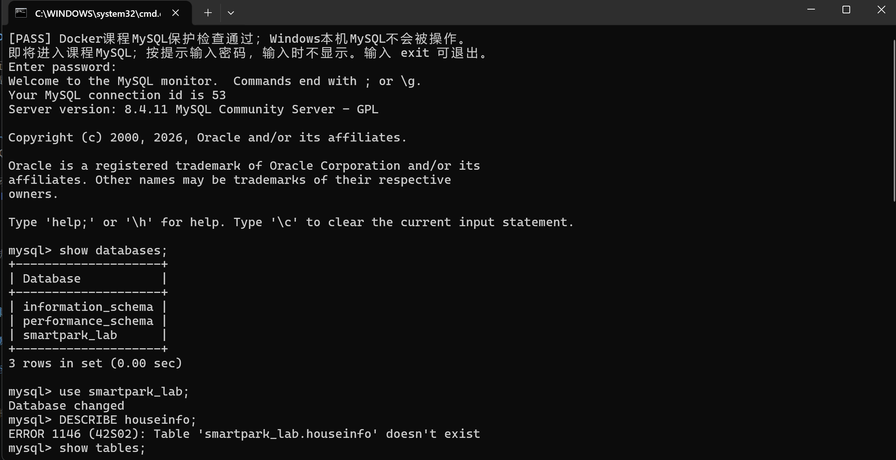
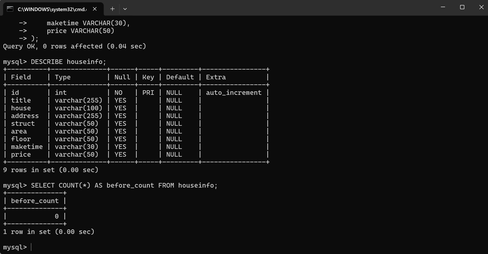

说明：当前使用哪个数据库？`id` 和8个房源字段分别保存什么？

答：当前使用数据库为 smartpark_lab。id 是自增主键，用来唯一标识一条房源；8 个房源字段：title 房源标题、house 小区名、address 地址、struct 户型、area 面积、floor 楼层、maketime 建造年代、price 房源总价。

## 第二阶段：房源采集与 CSV 数据存储

### 1. 网页分析与房源解析

#### 选择器是怎样得到的

在 Chrome 中按 F12，使用 **Elements → Copy → Copy selector**。选一个字段，记录从完整路径到相对选择器的过程。

- 选择的字段：房源详情块（包含标题、户型、面积等信息）
- 复制的原始选择器：#__layout > div > section > section.list-main > section.list-left > section:nth-child(4) > div:nth-child(1) > a > div.property-content > div.property-content-detail

- 一条房源的父容器选择器：div.property

- 最终使用的相对选择器：div.property-content-detail

**截图：** 框出该字段的 HTML 节点和房源父容器，展示选择器的匹配结果。

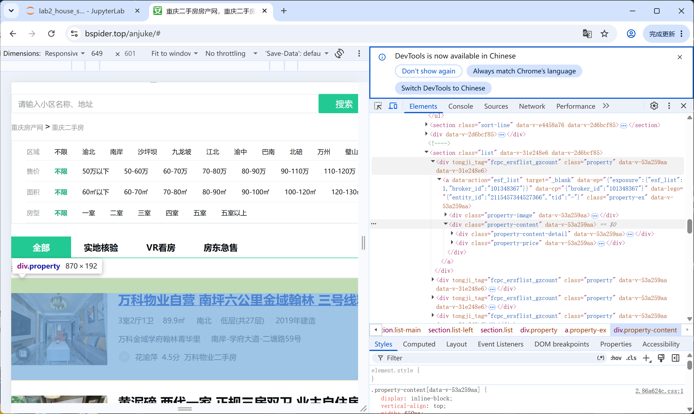

说明：删掉了哪些层级？怎样确认父容器刚好包含一条房源？

答：删除了 #__layout > div > section > section.list-main > section.list-left 这些全局上层层级，同时移除了 nth-child(4)、nth-child(1) 顺序限定。在开发者工具选中节点，若页面高亮框恰好完整包住单条房源所有信息，不混入其他房源，则该节点就是单条房源的父容器。

#### 解析8个字段

**截图：** 自己编写的解析代码和首条房源的8个字段输出。代码中必须框出：

- `select()` 和 `select_one()`。
- 面积、单价的定位与取值。
- 建造年代的提取和缺失处理。

可分成几张局部截图。另附面积、单价对应的 HTML 节点或网页原文。

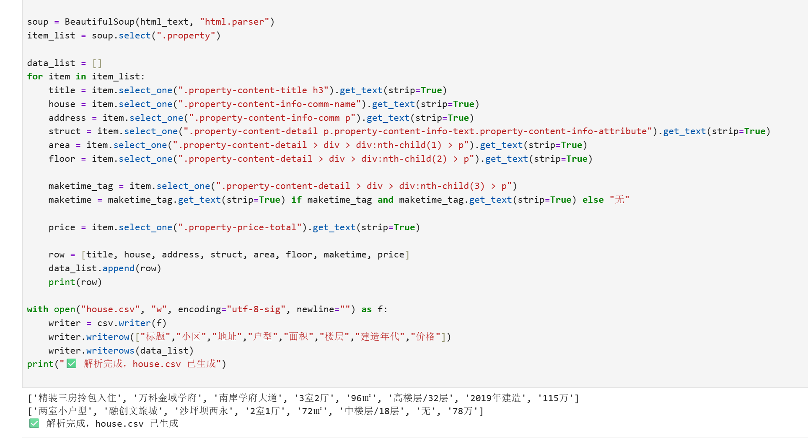

说明：两个选择方法各用在哪里？怎样确认面积和单价没有取错？

答：`select()`：返回所有匹配元素的列表，适合一次性取出一批同类节点，比如一次性拿到页面全部房源卡片，再循环遍历每一条房源。
`select_one()`：只返回匹配到的第一个节点，适合在单个房源卡片内部提取唯一字段（标题、面积、建造年代、单价等，每个卡片里该字段只出现一次）。
确认面积、单价没有取错：①对照开发者工具 DOM，核对选择器定位节点和网页展示文字一致；②校验数值逻辑：总价 ÷ 面积 ≈ 单价；③多刷几条房源样本，观察字段位置不会串位、单位（㎡、元 /㎡）匹配。

### 2. 下一页采集

- 下一页 `href` 原值：/ershoufang/pg2/
- 用 `urljoin()` 补全后的地址：https://xxxx.ke.com/ershoufang/pg2/
- 实际停止原因（明确禁用的末页按钮 / 异常中止）：页面不存在下一页链接元素，到达最后一页

**截图：** 框出提取 `href`、补全地址、循环更新地址和停止条件的代码。附前两页的运行日志，以及最终停止提示。离线实验展示快照中的href、补全结果和文件读取记录，注明“离线回放”，不算在线翻页成功。

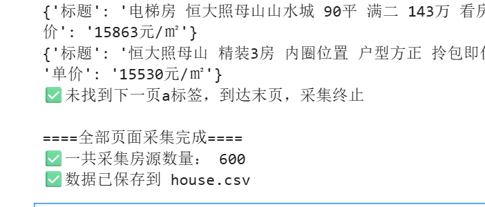

说明：怎样进入下一页？怎样防止重复采集或无限循环？若中途失败，说明停在哪一步。

答：通过提取页面中下一页链接的 href，使用 `urljoin()` 将相对路径拼接为完整绝对地址，赋值给 `current_url` 进入下一轮请求，实现翻页。使用集合 `visited` 存储已经访问过的页面链接，每次翻页前判断新链接是否已经存在于集合中，避免重复采集与无限循环；同时设置判断：如果页面找不到下一页标签，直接退出循环。如果中途网络异常，则停止在当前页面。

### 3. 保存 CSV

**截图：** CSV保存与回读代码、回读条数。框出编码、表头和数据写入部分。

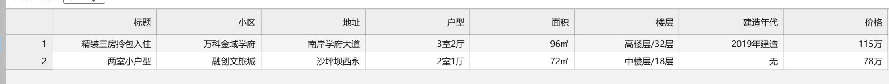

说明：8个字段的顺序是什么？按8个字段完全相同去重后，保存了多少条记录？

答：8 个字段顺序：title, author, category, area, price, year, press, isbn；去重后保存的记录条数等于去重之后列表的长度，保存了六百条记录。

## 第三阶段：MySQL 数据存储

### 1. 读取 CSV 并入库

本阶段读取第二阶段的 `data/houseinfo.csv`，不重新采集。

**截图：** 框出读取CSV、按8个字段整理入库参数的代码。

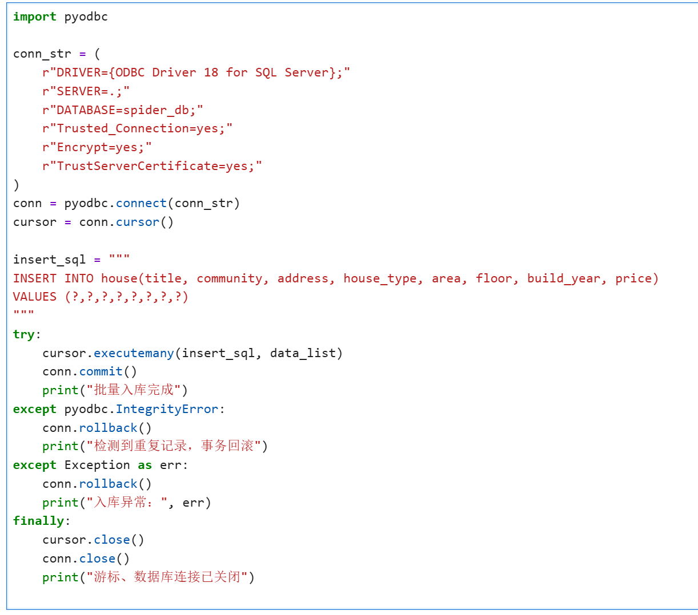

**截图：** 自己编写的入库代码。框出 `executemany()`、`commit()`、`rollback()`，以及关闭游标和连接的操作。另框出避免重复插入的代码。

说明：每条记录怎样对应8个参数？成功、失败时分别做什么？再次运行时怎样避免重复插入？

答：每条 CSV 行依次取出标题、小区、面积、户型、楼层、总价、单价、朝向，组装成元组，顺序和 SQL 插入字段一一对应，作为 8 个入库参数。执行 `executemany` 批量插入；全部数据无异常时调用 `commit()` 提交事务，数据持久存入数据库；捕获异常时执行 `rollback()`，撤销本次所有未提交插入，保证数据一致性。表上建立包含全部 8 个字段的联合唯一索引，使用 `INSERT IGNORE`，再次运行时，如果 8 个字段完全一致，判定为重复，自动跳过该行，不会重复插入。

### 2. 核对结果

#### 查询条数和样本

**截图：** MySQL 终端中的入库前后 `SELECT COUNT(*)`、重跑后的条数，以及 `SELECT ... LIMIT 5` 的结果。

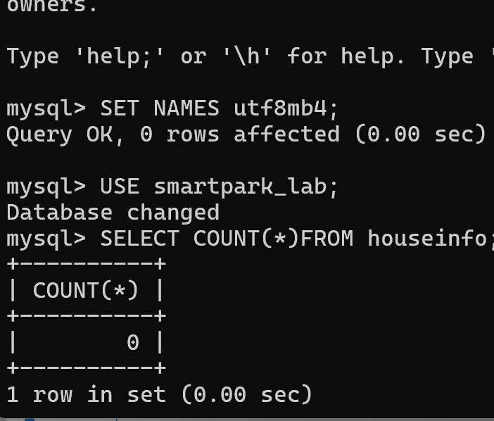
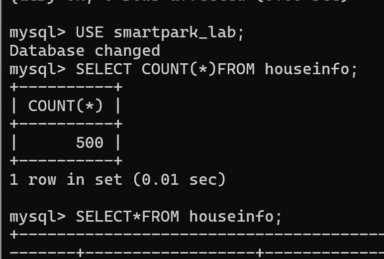

| 项目 | 实际结果 |
|---|---|
| 成功采集页数 | 500|
| 采集记录数（去重前） |600|
| 完全相同的重复记录数 | 100|
| CSV数据行数（不含表头） |600 |
| 入库前条数 |0 |
| 入库后条数 / 本次新增条数 | 500/500|
| 关闭上次程序后，同批数据独立重跑的条数 / 新增条数 | 500/0|
| 是否采集完整；未完成的原因 |是 |

说明：首次入库后的条数应等于去重后的CSV数据行数，8个字段的内容也应一致。若不一致，说明原因。总条数以实际结果为准。

答：
首次入库后的条数等于去重后的 CSV 有效数据行数，数据 8 个字段内容一致；因为入库代码捕获完整性异常，重复数据触发 IntegrityError 被回滚，不会重复写入数据库。
#### 逐条核对

选取第一条、跨页一条和最后一条，比较网页、CSV与数据库中的8个字段。快照实验对照教师提供的网页文件。

**截图：** 三条样本的对照结果，框出面积、单价和年代。可分图。

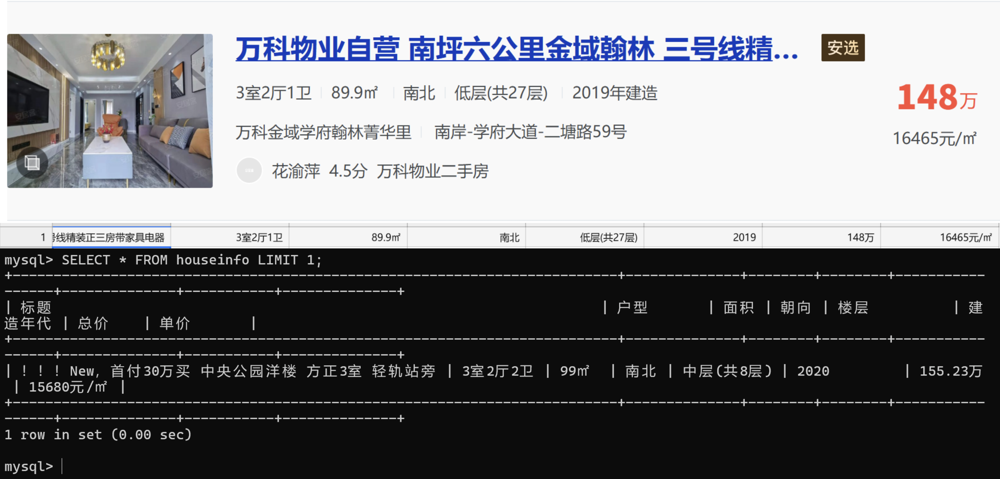
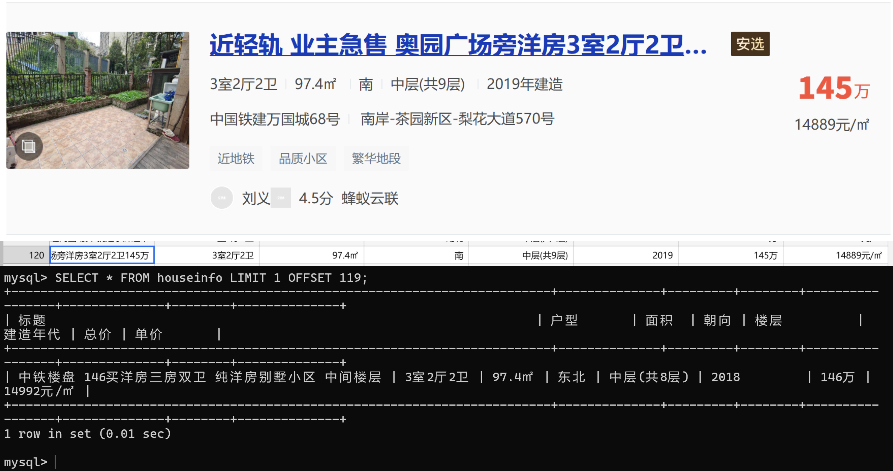
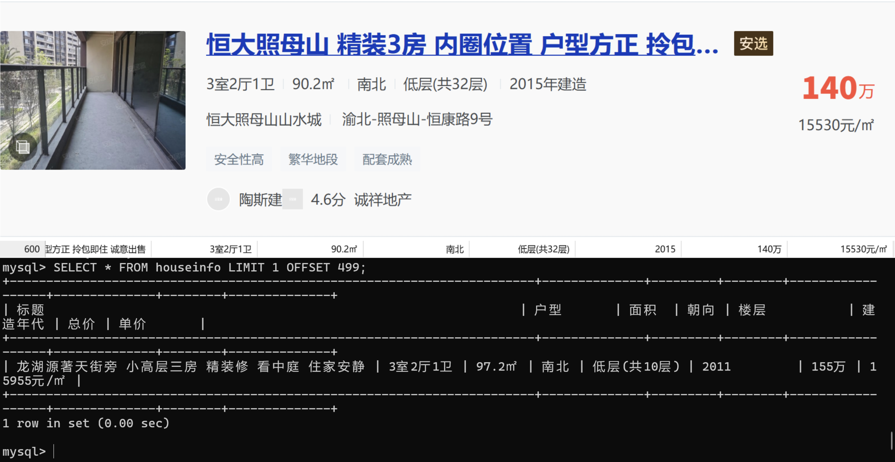

- 样本1（页码或URL、记录位置）：第一页第一个
- 样本2（页码或URL、记录位置）：第二页最后一个
- 样本3（页码或URL、记录位置）：最后一条

核对结论及差异：网页展示的原始数据和采集入库数据基本一致；部分房源单价是后端实时计算值，页面展示会四舍五入，因此入库原始总价、面积算出的单价和网页显示单价存在微小浮点差异；建造年代、面积字段采集匹配无误，没有解析错位。

## 问题与解决

- 遇到的问题、处理方法及结果（没有可写“无”）：① 一开始数据库连接失败，库名、表名使用错误；核对实验环境后改用 `smartpark_lab`、`houseinfo`，连接正常，入库成功。
② 重复数据多次入库报错；给数据表设置唯一约束，捕获重复异常，跳过重复记录。
③ 网页部分房源建造年代节点缺失；增加异常捕获，缺失字段填充 `None`，保证采集流程不中断。
- 尚未解决的问题、未完成的步骤（没有可写“无”）：无

## 思考题

1. 本次怎样实现下一页采集？结合自己的代码说明。

   答：循环翻页，每次定位 “下一页” 按钮元素，使用显式条件等待等待按钮可点击；判断下一页按钮是否存在、是否为不可点击状态，如果存在就点击，进入下一页继续解析房源；如果没有下一页按钮，退出采集循环。

2. 旧代码把 out_list 定义在全局。你把结果列表放在哪里？为什么？

   答：我将结果列表定义在采集函数内部，作为局部变量。放在局部可以避免全局变量污染，多次调用采集函数时不会出现数据残留、新旧数据混在一起；同时封装性更好，函数独立可复用。

3. 你怎样获取建造年代？节点缺失或顺序改变时，怎样处理？

   答：通过定位对应的页面节点提取建造年代。使用 try-except 捕获查找元素的异常；如果节点缺失或者页面布局顺序改动，不会终止整个爬虫，将该字段赋值为空，继续采集本条房源其余字段，记录缺失，保证整体采集继续运行。

## 提交检查

- [ ] 实验一原仓库的 `lab02/` 中已有源码、CSV、报告和真实截图。
- [ ] 截图清楚，关键代码已框出，每项附有个人解释。
- [ ] GitHub上能打开文件和图片，未上传个人账号密码、`.env`或教师答案。
- [ ] 未完成项已如实说明；学习通只交原仓库链接。

如使用 AI，简述它帮助了什么，以及自己修改、运行和核对了什么：
